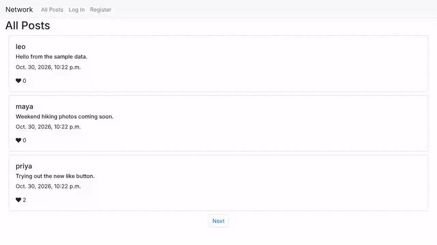

# Network

A small Twitter-like social network built with Python and Django. Users can write posts, like and unlike posts, edit their own posts and follow other users, and the Following page shows posts only from people they follow. This was Project 4 ("Network") of Harvard's CS50 Web Programming with Python and JavaScript course.



The demo was recorded on a local copy with sample users and posts. An earlier video walkthrough is also on [YouTube](https://youtu.be/Ok-RpNIDM1A).

## Features

- **Accounts:** register, log in and log out.
- **All Posts:** every post from every user, newest first, with the author, the text, the time and the number of likes. Anyone can read the posts; logged-in users also get a "New Post" box at the top.
- **Pagination:** three posts per page, with Previous and Next buttons.
- **Likes:** clicking the heart likes or unlikes a post. This is done with `fetch`, so the heart turns red and the count updates without reloading the page.
- **Editing:** an Edit link appears on your own posts and opens the post in a form, pre-filled with its current text.
- **Following:** the profile page (your username in the navigation bar) shows how many followers you have and how many people you follow, and puts a Follow or Unfollow button next to other users' posts.
- **Following feed:** the Following page lists only the posts of users you follow.

## How it works

1. There are three models: `User` (based on Django's built-in user), `Post` (author, text, time and a many-to-many list of users who liked it) and `Profile`, which stores one follower/following pair per row.
2. The index view saves new posts through a Django form (`PostForm`) and uses Django's `Paginator` to split the posts into pages of three.
3. `index.js` sends likes and follows to the server as JSON `POST` requests to `/like` and `/profile`, including the CSRF token from the cookie. The server adds or removes the like (or the follow) and replies with JSON.
4. The Following view collects the users you follow from your `Profile` rows and then gathers their posts.

## Project structure

```
project4/                 Django project settings and URLs
network/                  The app
├── models.py             User, Post and Profile models
├── views.py              Posts, pagination, likes, follows, editing and accounts
├── forms.py              PostForm (used for new posts and edits)
├── urls.py               URL routes
├── templates/network/    layout, index, profile, following, edit, login and register pages
└── static/network/
    ├── index.js          Like and follow buttons (fetch requests)
    └── styles.css
```

## Running it locally

The migrations were made with Django 3.1.3. I tested it with **Python 3.9** and Django 3.1.3.

```bash
python3.9 -m venv venv
source venv/bin/activate
pip install Django==3.1.3
python manage.py migrate
python manage.py runserver
```

Then open http://127.0.0.1:8000 and register an account. To try likes and follows, register a second account in a private window.

The pages load Bootstrap and Font Awesome (for the heart icon) from public CDNs, so they need an internet connection to look right.

## Built with

- **Backend:** Python, Django 3.1, SQLite
- **Frontend:** HTML, CSS, Bootstrap 4, Font Awesome and JavaScript (`fetch`)

## Course credit

This project was built for [CS50's Web Programming with Python and JavaScript](https://cs50.harvard.edu/web/2020/) from Harvard University. The project description is [here](https://cs50.harvard.edu/web/2020/projects/4/network/). The login, logout and registration views and the `User` model came with the course's starter code.

Created by Sangye Tenphel, 2021.
